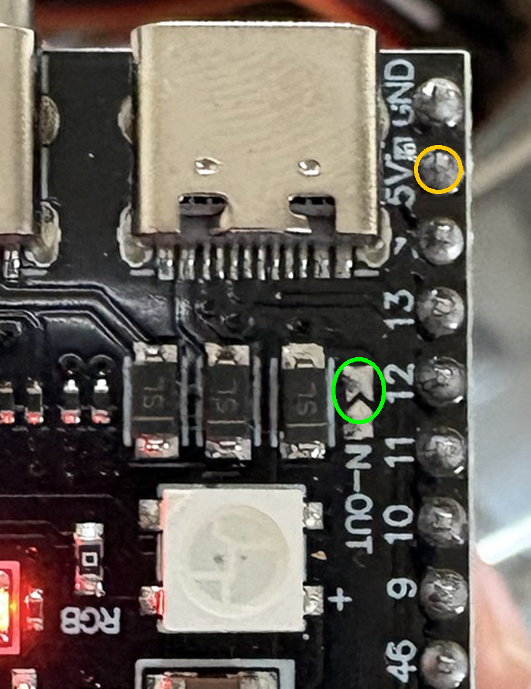

# Build Guide (beginner friendly)

Work through the phases in order. Each phase ends with a test, and you only
move on when the test passes. Don't build the whole thing at once: if it
doesn't work, you won't know which part is at fault.

## Parts I identified from your photos

| Part | What it does in this project |
|------|------------------------------|
| ESP32-S3 N16R8 board | The brain. Wi-Fi, 16 MB flash, 8 MB PSRAM |
| INMP441 I2S microphone module | Digital microphone, good quality for speech |
| SD card module ("Arduino SD Kart Modülü") | Saves recordings. **You need a microSD card (8–32 GB) if you don't have one** |
| DS3231 RTC module (Raspberry Pi type) | Keeps the date and time so files get real names |
| Waveshare 2.13" e-Paper (250×122) | Low-power status screen (phase 4) |
| TP4056 Type-C LiPo charger module(s) | Charges the battery (phase 5) |
| LiPo battery 3.7 V | Power (phase 5) |
| Push buttons (red 16 mm, metal, 6 mm tactile) | Start/stop recording |
| On/off slide switch | Main power switch (phase 5) |
| 5 mm LEDs (red, blue, white) + 330 Ω resistors | Recording / status lights |
| Breadboard, female-female jumper wires, pin headers | Prototyping without soldering |
| Perfboard | Final soldered version (phase 6) |

Two things worth checking:
- **Battery charger:** there seem to be two small blue charger/power boards.
  Before phase 5, send a close-up photo of both (front and back) so the battery
  wiring can be confirmed. Mistakes with LiPo batteries can cause fires, so
  don't guess this part.
- **USB cable:** you need a USB-C **data** cable. Some cables only charge,
  and with those the computer won't see the board.

---

## Phase 0: Software setup and first blink (no soldering)

1. Install **Arduino IDE 2** from arduino.cc.
2. *File → Preferences → Additional boards manager URLs*, paste:
   `https://espressif.github.io/arduino-esp32/package_esp32_index.json`
3. *Tools → Board → Boards Manager*, search **esp32** and install
   "esp32 by Espressif Systems" (version 3.x).
4. Plug the ESP32-S3 into the laptop. If the board has two USB-C ports, use
   the one labelled **COM** or **UART**.
5. In *Tools*, set:
   - Board: **ESP32S3 Dev Module**
   - Port: the new COM port that appeared
   - Flash Size: **16MB**
   - PSRAM: **OPI PSRAM**
   - USB CDC On Boot: **Enabled** (only needed if you use the port labelled USB)
6. *File → Examples → 01.Basics → Blink*, then click Upload (→).
   Many S3 boards have an RGB LED instead of a plain one; if nothing blinks
   but the upload says "Done", that's fine. Phase 1 will prove it works.

**If the upload fails:** hold the **BOOT** button, press and release **RST**,
release **BOOT**, then upload again.

## Phase 1: Solder headers, then test the microphone

### Soldering the headers
Your INMP441 (and maybe the ESP32) came with loose pin strips. To keep them
straight:
1. Push the long side of the pin strip into the breadboard.
2. Put the module on top, so the short pins stick up through its holes.
3. Solder each pin: touch the iron to **both** the pin and the copper ring
   for 1–2 s, feed in a little solder, remove solder, then iron. You want a
   shiny little cone shape, not a ball.
4. Don't let solder bridge two neighbouring pins.

### Wiring the mic (use female-female jumpers, board → module)

The ESP32-S3 is too wide for a breadboard with free holes on both sides, so
connect modules directly with the female-female jumper wires.

| INMP441 pin | ESP32-S3 pin |
|-------------|--------------|
| VDD | **3V3** (not 5V!) |
| GND | GND |
| L/R | GND |
| SCK | GPIO 4 |
| WS  | GPIO 5 |
| SD  | GPIO 6 |

### Test
1. Open `firmware/01_mic_test/01_mic_test.ino` in Arduino IDE and upload it.
2. Open *Tools → Serial Plotter*, set baud to **115200**.
3. Talk or clap. The line should jump up when there's sound and stay low when
   it's quiet.

If it stays flat at 0, check the wires (SCK/WS/SD swapped is the usual
mistake) and that L/R is connected to GND.

## Phase 2: Record to the SD card with a button

Keep the mic wired as in phase 1 and add:

### SD card module
Format the microSD card as **FAT32** on your laptop first.

| SD module pin | ESP32-S3 pin |
|---------------|--------------|
| VCC | **5V** (the module has its own regulator; this works while USB is plugged in) |
| GND | GND |
| CS   | GPIO 10 |
| MOSI | GPIO 11 |
| SCK  | GPIO 12 |
| MISO | GPIO 13 |

### Button and LEDs (on the breadboard)
- **Button:** one leg → GPIO 1, other leg → GND. (No resistor needed; the
  ESP32 has one built in.) The 6 mm tactile buttons fit the breadboard. Use
  two legs on *different sides* of the button's middle gap.
- **Red LED (recording):** GPIO 2 → 330 Ω resistor → LED **long leg (+)**,
  LED short leg (−) → GND.
- **Blue LED (ready):** GPIO 42 → 330 Ω resistor → LED long leg, short leg → GND.

To connect a female jumper to the breadboard, break off a single pin from the
pin header strip and use it as a plug.

### Check the card first
Pins 10–13 are the ESP32-S3's default SD pins, so Arduino's built-in test
works without changes: **File → Examples → SD → SD_Test**. Upload it, open
the Serial Monitor (115200) and press RST. It shows the card type and size and
lists the files already on the card. It also leaves a few small test files
behind; they do no harm.

### Test
1. In `firmware/02_sd_recorder/02_sd_recorder.ino`, put in your Wi-Fi name and
   password (2.4 GHz only), then upload.
2. Open the Serial Monitor (115200). Blue LED on means it's ready. Note the
   `http://...` address it prints.
3. Press the button: the red LED comes on and it's recording. Talk for a minute.
4. Press again to stop. The file is saved as `REC_0001.WAV`, `REC_0002.WAV`...
5. Open the address in a browser on the same Wi-Fi and click the file to
   download it. No card reader needed. The page can also delete all files.

If the Serial Monitor says "SD card failed", check the 6 wires, that the card
is FAT32, and that the card is pushed all the way in.

Audio is 16 kHz mono, which is ideal for speech recognition: about
**115 MB per hour**, so an 8 GB card holds over 60 hours.

### No SD card yet? Record to the ESP32's memory and download over Wi-Fi

`firmware/02b_flash_recorder` uses the same mic, button and LEDs, but no SD
card. It holds about **5 minutes** of audio, which is enough for testing.

1. In the sketch, replace `your-wifi-name` and `your-wifi-password` with your
   Wi-Fi details. Only 2.4 GHz networks work; most home routers offer one.
2. Set **Tools → Partition Scheme → 16M Flash (3MB APP/9.9MB FATFS)**, then upload.
3. The Serial Monitor (115200) prints an address like `http://192.168.1.42`.
   Open it in a browser on a laptop or phone on the same Wi-Fi.
4. Record with the button, stop, then refresh the page and click the file to
   download it.

When buying a card, get **16 or 32 GB**. Windows can't format larger cards as
FAT32 without extra tools.

---

## What comes next (to be written once phase 2 works)

- **Phase 3:** a Python script on your laptop. Drop a WAV in a folder and get
  a transcript (Whisper, runs free on your laptop) and a summary with action
  items (Claude API).
- **Phase 4:** DS3231 clock (I2C: SDA → GPIO 8, SCL → GPIO 9) so files are
  named like `2026-10-20_1430.WAV`, and the e-paper screen showing
  "● REC 00:12:34" and battery level.
- **Phase 5:** battery, charger and power switch. Send photos of the charger
  boards first.
- **Phase 6:** the device uploads recordings over Wi-Fi automatically. Then
  move everything from jumper wires to the perfboard and into a case.

### Pins reserved so far (don't reuse these)

| GPIO | Used for |
|------|----------|
| 1 | Button |
| 2 | Red LED |
| 4, 5, 6 | Microphone |
| 8, 9 | DS3231 clock (phase 4) |
| 10–13 | SD card |
| 14–18, 21 | e-Paper (phase 4) |
| 42 | Blue LED |
| 35, 36, 37 | **Never use.** Taken by the PSRAM on N16R8 boards |

## Troubleshooting: SD card reads garbage or writes fail (YD-ESP32-S3 boards)

On the YD-ESP32-S3 board, the **5V pin does not output USB power** unless
the small **IN-OUT** solder jumper is bridged (green circle below; the 5V pin
is the yellow circle). The full-size SD module is designed to run from 5V
through its own regulator, and on 3V3 it can misbehave: listing works but
writes fail, or the card reports "no valid FAT volume" even when the format
is correct.

Fix: unplug the USB and join the two IN-OUT pads with a small blob of
solder. Then wire SD module **5V → ESP32 5V**, leave the module's 3V3 pin
empty, and connect both of its GND pins to GND.

**After bridging, the 5V pin is wired straight to USB power. Never feed
another power source (such as a battery) into the 5V pin while USB is plugged in.**
